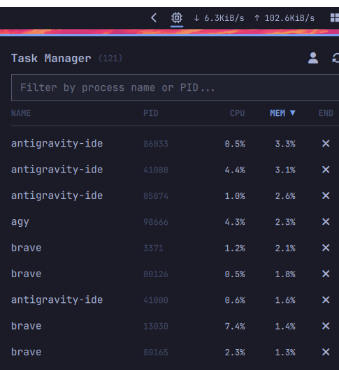

# Omarchy Task Manager

A fast, lightweight, and responsive Task Manager & Process Monitor for Omarchy Quattro.



## Features

- **Live Process Monitoring**: Real-time process listing with PID, CPU%, and Memory% usage.
- **Zero Idle Overhead**: Polling automatically pauses when the panel is closed (0% background CPU).
- **Instant Search & Filter**: Filter processes in real-time by executable name or PID.
- **Multi-Column Sorting**: Sort descending or ascending by CPU, MEM, or NAME.
- **Safe Process Termination**:
  - One-click termination (`SIGTERM`) for user processes.
  - Double-click within 3 seconds escalates to force-kill (`SIGKILL`).
  - Critical system and desktop session processes (`systemd`, `Hyprland`, `quickshell`, `wireplumber`, etc.) are locked and protected from accidental termination.
- **User vs. System Filter**: Toggle between displaying all system processes or user-owned processes only.
- **Keyboard Friendly**: Navigate with `j`/`k` or arrow keys, dismiss with `Esc`.

## Installation

Install directly via Omarchy:

```bash
omarchy plugin add https://github.com/khaledSayed93/omarchy-task-manager.git --enable
```

## Removal

To disable or remove the plugin:

```bash
# Disable from the bar
omarchy plugin disable io.github.khaledsayed93.task-manager

# Or remove completely
omarchy plugin remove io.github.khaledsayed93.task-manager --yes
```

## Usage

- **Click** the CPU (``) icon in the bar to open the Task Manager panel.
- **Click headers** (`CPU`, `MEM`, `NAME`) to sort processes.
- **Click `✕`** to terminate a process (`SIGTERM`). Click again within 3 seconds to force kill (`SIGKILL`).
- **Click the User icon** (`` / ``) to switch between user-only processes and all system processes.
- **Type in the search field** to instantly filter by process name or PID. Press `Esc` to clear search or close.

## Dependencies

- Uses native Linux utilities (`ps`, `kill`) via Quickshell `Process`.
- Zero external runtime or node dependencies.

## License

[MIT](LICENSE) © 2026 Khaled Sayed
